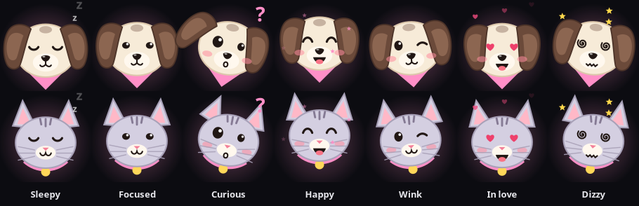

# Islet 🐾

A dynamic island for Linux. A small pill at the top of your screen that shows what your
AI coding agents, games, downloads and music are doing, with a pet that reacts to all of it.

Built for Wayland compositors with layer-shell (made on **Hyprland**), in Python with GTK 4.



## What it does

**AI agents (Claude Code and Codex)**
- Live status in the pill: "Puppy is editing lag.rs +7 −3", "Puppy is running npm test", "Puppy is done ✓".
- A live code view in the panel: the edit being made, red/green with syntax colours, typed out as it happens.
- Permission prompts as **Allow / Deny** buttons in the pill (⌨ hands it back to the terminal).
- A chime and a toast when an agent finishes or needs you.

**Everything else**
- **Now playing**: the game you're in (Steam via `SteamAppId`, Roblox via Sober) with play time, or the
  song/video that's playing (any MPRIS player). The panel has a full player page with cover art.
- **Mini player**: pop a browser video (YouTube etc.) out into a small window that stays on top of
  everything, including fullscreen games. Plays through libmpv; optional YouTube login from your browser.
- **Steam downloads** and **browser downloads** with progress bars.
- **System updates**: pacman (`checkupdates`), AUR (`yay`) and Flatpak counts, a daily update time,
  and a skip list for broken packages.
- **Timer**, clock, music tile, and your own **script buttons** (run `vr-up` or anything else from the
  panel and follow its output).
- **hyprclick / lagswitch**: clicker, anti-AFK, freezes and fake lag show up in the island.
- **Toasts** instead of desktop notification popups, with a 🔔 history page.
- A **welcome** when you log in ("Good evening, Sam! 🐾"), using your account's display name.
- Pets: a pup and a kitty, rename them, poke them (5 fast pokes = dizzy, double-click = love).

**Behaviour**
- Drag the pill anywhere, across monitors too, or pick the monitor in Settings.
- Click the pill for the dashboard; click outside or press Esc to close it.
- Everything is optional and can be switched off in Settings → Show in the island.

## Install

Arch Linux packages:

```bash
sudo pacman -S gtk4 gtk4-layer-shell python-gobject python-cairo playerctl libnotify pipewire
# optional: mini player, updates, Steam/Flatpak bits
sudo pacman -S mpv yt-dlp deno pacman-contrib flatpak
```

Then:

```bash
git clone https://github.com/AriCuteGirl/islet.git
cd islet
python3 islet.py install   # adds Claude Code + Codex hooks, links ~/.local/bin/islet
islet &
```

Autostart on Hyprland (Lua config), e.g. in a file loaded from `hyprland.lua`:

```lua
hl.on("hyprland.start", function() hl.exec_cmd(os.getenv("HOME") .. "/.local/bin/islet") end)
```

(or `exec-once = islet` in a classic `hyprland.conf`).

`python3 islet.py uninstall` removes only Islet's hooks (backups are kept as `*.islet-bak`).
If Islet isn't running, the hooks do nothing and your agents behave as normal.

## Commands

```
islet                       run the island (restarts itself if it crashes)
islet allow | deny | terminal   answer a waiting permission prompt (bind these to keys)
islet toggle | open home|media|updates|settings|inbox
islet monitor 1|2|next|NAME move the island to a monitor
islet pet pup|kitty         switch pets
islet mini                  pop the playing browser video out into the mini player
islet run NAME              press one of your script buttons
islet welcome               show the login hello again
islet push --app APP --title T [--detail D] [--color #hex] [--ttl SECS] [--progress 0..1]
islet clear --app APP [--id ID]
islet toast --app APP --title T [--body B] [--color #hex]
```

Any script can show things in the island with `islet push` / `islet toast`, or by sending one JSON
line to `$XDG_RUNTIME_DIR/islet.sock`.

## Files

| File | What |
| --- | --- |
| `islet.py` | CLI, agent hook (stdlib only, fast), install/uninstall, crash watchdog |
| `island.py` | the window: pill, events, layout, dragging, alerts, socket server |
| `dashboard.py` | the panel: home, Now Playing, updates, notifications, settings |
| `model.py` | config, sounds, agent event parsing |
| `pets.py` | the pets, drawn with cairo |
| `highlight.py` | live code view (diffs + syntax colours) |
| `sources.py` | watchers: hyprclick/lagswitch, Steam, downloads, games, custom commands |
| `updates.py` | pacman / AUR / Flatpak updates |
| `actions.py` | script buttons |
| `miniplayer.py` | mini player (libmpv render API via ctypes, in a GTK GL area) |
| `ytproxy.py` | local stream proxy for the mini player |

Config lives in `~/.config/islet/config.json`, logs and caches in `~/.cache/islet/`.

## Privacy

Everything stays on your PC. The agent hooks talk to a local socket only. The mini player's
optional YouTube login is read from your browser by yt-dlp on your machine and only sent to YouTube.

## License

MIT
